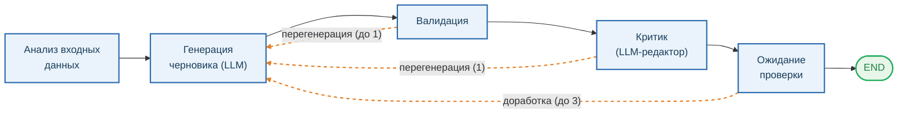
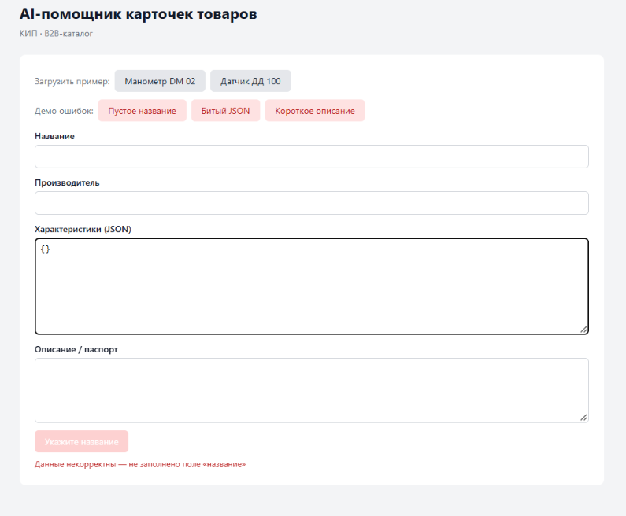
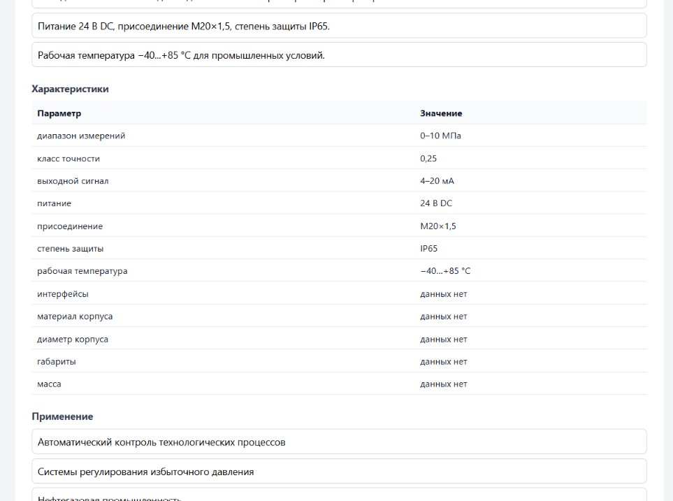
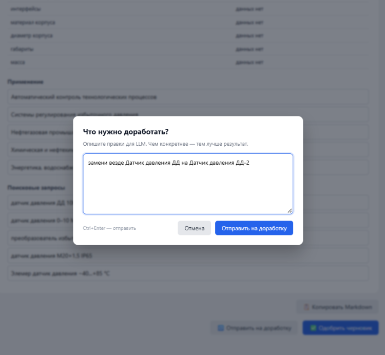
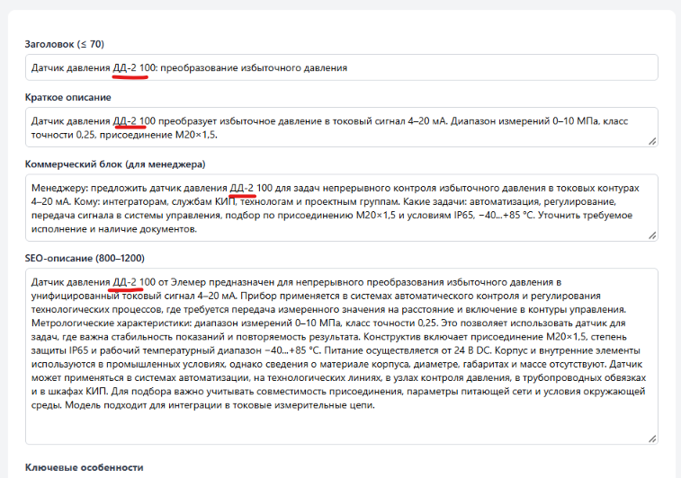

# AI-помощник карточек товаров (КИП)

Прототип сервиса, который по входным данным о контрольно-измерительном приборе (КИП)
генерирует черновик карточки товара для B2B-интернет-магазина: SEO-заголовок и описание,
структурированные характеристики, поисковые запросы и коммерческий блок для менеджера.

**Стек:** Python 3.11+ · FastAPI · LangGraph · Vue 3 · Vite  
**LLM:** OpenAI `gpt-4o-mini` или DeepSeek `deepseek-chat` — переключается через `.env`.

---

## 1. Как работает агент

Агент — это граф на LangGraph из пяти шагов с тремя точками ветвления
(валидатор, критик и human-in-the-loop). Состояние сохраняется между HTTP-запросами
через checkpointer, поэтому человек может вмешаться в любой момент.



**Что делает каждый шаг:**

| Шаг | Что происходит |
|---|---|
| **Анализ входных данных** (`prepare_input`) | Считает `missing_fields` — каких полей из `EXPECTED_SPEC_FIELDS` не хватает во входе. Сами `specifications` копируются кодом, а не генерируются LLM. |
| **Генерация черновика (LLM)** (`generate_draft`) | Модель по `GENERATE_PROMPT` пишет SEO-заголовок (≤ 70 символов), SEO-описание (800–1200 символов; при ≥ 8 отсутствующих полях минимум снижается до 400 — см. раздел 7), 3–5 поисковых запросов и `commercial_block` (200–400 символов). Жёсткие лимиты по полям, запрет на числа вне `specs`, список стоп-фраз. |
| **Валидация** (`validate_draft`) | Проверяет длины, формат, регекспом ищет выдуманные числа во всём тексте. Ошибки возвращаются обратно в LLM для перегенерации (до 1 итерации). |
| **Критик (LLM-редактор)** (`critic`) | Строгий редактор по `CRITIC_PROMPT` сверяет черновик с `raw_specs`: повторы, филлеры, мета-текст, путаница в терминах, выдуманные числа, длины полей. Максимум 1 итерации. |
| **Ожидание проверки** (`human_review`) | `interrupt()` — граф останавливается, менеджер видит черновик в UI и может принять его или отправить на доработку (до 3 раз). Счётчики итераций сбрасываются. |

**Почему именно LangGraph.** Задача — не единичный вызов LLM, а цикл с тремя точками ветвления
(валидатор, критик и human-in-the-loop), с сохранением состояния
между HTTP-запросами. LangGraph даёт `interrupt()` и checkpointer из коробки;
альтернатива — вручную писать state-машину с сериализацией в БД — для прототипа дороже.

**Защита от галлюцинаций:**

- `specifications` формируются кодом — модель не может их потерять или выдумать.
- Промпт запрещает числа вне `specs` и перечисляет стоп-фразы
  («высокое качество», «соответствует требованиям», «по паспорту» и т.п.).
- `validate_draft` регекспом ловит выдуманные числа → перегенерация с явным списком ошибок.
- LLM-критик сверяет числа, повторы и терминологию с `raw_specs`.
- Отсутствующие поля из `EXPECTED_SPEC_FIELDS` помечаются в таблице как «данных нет».

---

## 2. Что реализовано (соответствие ТЗ)

| Требование ТЗ | Реализация |
|---|---|
| Приём данных в JSON или через веб-форму | CLI (`cli.py`) + Vue UI (`frontend/`) |
| Передача в LLM через API | `backend/app/graph.py` → AsyncOpenAI |
| Формирование черновика карточки | узел `generate_draft` + Pydantic-схема `LLMCard` |
| Возврат в удобном виде | Markdown-экспорт `/api/drafts/export/markdown` + кнопка «Копировать» в UI |
| Сообщение об отсутствующих полях | `missing_fields` + пометка «данных нет» в таблице характеристик |
| SEO-заголовок ≤ 70 символов | проверяется в `validate_draft` |
| SEO-описание 800–1200 символов | проверяется в `validate_draft`, промпт требует деловой тон. При ≥ 8 отсутствующих полях нижняя граница снижается до 400 — **осознанное послабление**, чтобы не вынуждать модель выдумывать (см. раздел 7) |
| Структурированные характеристики | `specifications` копируются из входа кодом — модель не может их потерять или выдумать |
| 3–5 поисковых запросов | `search_queries` + валидация длины |
| Commercial-блок для менеджера | `commercial_block` 200–400 символов |
| API-ключ не в коде | `.env` в `.gitignore`, шаблон `.env.example` |
| Обработка ошибок API | `AuthenticationError`, `RateLimitError`, `TimeoutError` → понятные сообщения |
| Обработка пустых/некорректных данных | Pydantic-валидация `ProductInput` + UI-подсказки |
| Модель не выдумывает характеристики | `specifications` формируются кодом; `validate_draft` регекспом ловит выдуманные числа |
| Пометка «данных нет» | отсутствующие поля из `EXPECTED_SPEC_FIELDS` автоматически добавляются с этим значением |

---

## 3. Быстрый старт

### 3.1. Backend + встроенный фронтенд (одна команда)

```bash
cd backend
python -m venv .venv && source .venv/bin/activate   # Windows: .venv\Scripts\activate
pip install -r requirements.txt
cp .env.example .env        # вписать OPENAI_API_KEY (для DeepSeek — тот же ключ, но изменить OPENAI_BASE_URL и MODEL_NAME)
uvicorn app.main:app --port 8000
```

В папке `frontend/dist` лежит собранный фронтенд — он автоматически раздаётся
FastAPI и доступен на http://127.0.0.1:8000.
⚠️ Состояние сессий хранится в памяти процесса (`MemorySaver`): после рестарта `uvicorn` незавершённые черновики теряются, `/resume` для них вернёт 404. Это ожидаемое поведение прототипа — см. раздел 7.

### 3.2. Режим разработки фронтенда

Если по какой-то причине встроенный фронтенд не запустился:

```bash
cd frontend
npm install
npm run dev
```

UI будет доступен на http://localhost:5173 (Vite-прокси перенаправит запросы на бэкенд).

### 3.3. CLI

```bash
cd backend
python -X utf8 cli.py fixtures/product_1.json
```

---

## 4. Примеры

### 4.1. Скриншоты UI

Пошаговый вид интерфейса: от ввода данных до готовой карточки.

| Шаг | Скриншот |
|---|---|
| 1. Форма ввода данных о товаре |  |
| 2. Процесс генерации (статус узлов графа) |  |
| 3. Черновик карточки на проверке |  |
| 4. Отправка на доработку с комментарием |  |
| 5. Готовый результат (после правки с комментарием) |  |

**Входные данные** — в `backend/fixtures/`:

- `product_1.json` — Манометр показывающий DM 02 (Манотомь)
- `product_2.json` — Датчик давления ДД 100 (Элемер)

**Сгенерированные карточки** — в `examples/`:

- `examples/product_1.md`
- `examples/product_2.md`

**Перегенерация из CLI:**

```bash
cd backend
python -X utf8 cli.py fixtures/product_1.json > ../examples/product_1.md
python -X utf8 cli.py fixtures/product_2.json > ../examples/product_2.md
```

---

## 5. Архитектура и промпты

Граф LangGraph, состав узлов и правила ветвления описаны в разделе
[1. Как работает агент](#1-как-работает-агент).

**Ключевые промпты** — `backend/app/prompts.py`:

- **`GENERATE_PROMPT`** — жёсткие лимиты по полям, запрет на числа вне `specs`,
  список стоп-фраз, запрет путать «диапазон измерений» и «верхний предел».
- **`CRITIC_PROMPT`** — строгий редактор: сверяет черновик с исходными `raw_specs`
  по критериям (повторы фактов, филлеры, мета-текст, путаница в терминах,
  выдуманные числа, длины полей).

---

## 6. Как проверить

Быстрая проверка без LLM (валидация входа):

```bash
cd backend
python scripts/run_tests.py --only=A
```

---

## 7. Ограничения и возможные улучшения

| Ограничение | Комментарий |
|---|---|
| `missing_fields` — эвристика по фиксированному списку полей КИП | Для других доменов нужно править `EXPECTED_SPEC_FIELDS` |
| Минимальная длина `seo_description` снижается до 400 при ≥ 8 отсутствующих полях | **Осознанное послабление** относительно ТЗ (800–1200). Причина: при малом объёме данных длинное описание заставляет модель выдумывать факты, а это прямо запрещено ТЗ. Приоритет «не выдумывать» над формальной длиной. Реализовано в `validate_draft` (`MIN_SEO_LEN_SPARSE`) и продублировано в проверках категории B (`scripts/run_tests.py`, `_assert_draft_quality`) |
| Однозначные числа (5 бар, G1/4) не проверяются | Слишком много ложных срабатываний (класс точности 1, IP65, 24 В). Осознанный компромисс |
| Чекпоинтер | Везде используется `MemorySaver` (in-RAM). **Состояние теряется при рестарте `uvicorn` / reload.** Это осознанное упрощение прототипа: `CHECKPOINT_DB` из `.env` сейчас не подключается — `get_async_graph()` пишет warning и игнорирует его, чтобы не тащить async-инициализацию sqlite в lifespan. Для сохранения сессии между перезапусками нужен `AsyncSqliteSaver` (реализуется возвратом AsyncSqliteSaver в `get_async_graph` + `await saver.setup()`); для продакшена — Postgres-checkpointer |
| `with_structured_output` не используется | Осознанный отказ от `with_structured_output` в пользу собственного парсинга JSON с одним retry (`_invoke_structured` в `graph.py`). Причина: механизм стабилен с OpenAI, но менее предсказуем с DeepSeek и «OpenAI-совместимыми» провайдерами (разные форматы ответа, обёртки ```json, trailing comma). Собственный парсер (`_extract_json` + усиленный hint при повторе) даёт единообразное поведение независимо от провайдера. |
| `POST /resume` не стримит прогресс | Может занимать несколько минут при перегенерации; на фронте стоит `AbortSignal.timeout(600_000)` (`RESUME_TIMEOUT_MS` в `App.vue`) |
| Лимиты итераций | до 1 на валидаторе (`MAX_VALIDATION_RETRIES = 1`), до 1 на критике (`critic_iteration >= 1`), до 3 на `human_review` (`iteration >= 3`) |

---

## 8. Структура проекта

```
.
├── backend/
│   ├── app/
│   │   ├── api.py            # FastAPI-роутеры, SSE-стрим, Markdown-экспорт
│   │   ├── config.py         # pydantic-settings, загрузка .env
│   │   ├── graph.py          # LangGraph-граф, узлы, роутеры
│   │   ├── main.py           # FastAPI-приложение, CORS, SPA-fallback
│   │   ├── prompts.py        # GENERATE_PROMPT, CRITIC_PROMPT
│   │   └── schemas.py        # Pydantic-модели входа/выхода
│   ├── fixtures/             # Входные примеры (product_1.json, product_2.json)
│   ├── scripts/
│   │   ├── diag_llm.py       # Диагностика LLM-эндпоинта
│   │   └── run_tests.py      # Сценарные тесты A/B/C
│   ├── cli.py                # CLI-режим
│   ├── requirements.txt
│   └── .env.example
├── frontend/                 # Vue 3 + Vite
│   └── src/
│       ├── App.vue
│       ├── components/       # InputForm, DraftEditor, ApproveBar, StreamStatus
│       ├── types.ts
│       └── useDraftApi.ts    # SSE-клиент, resume, export
├── examples/                 # Сгенерированные карточки (product_1.md, product_2.md)
└── README.md
```